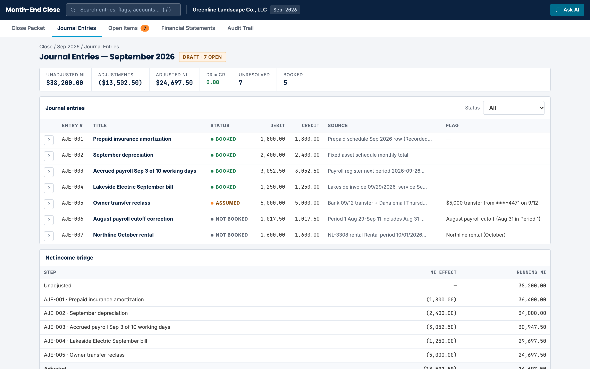
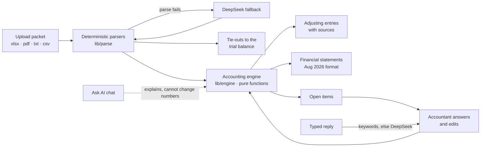

# Month-End Close

**An AI-assisted month-end close tool.** It reads a client's month-end packet, drafts the adjusting journal entries with a source on every line, flags what the documents don't settle, and produces draft financial statements that update live as the accountant answers and edits.

**[Live demo](https://month-end-close.vercel.app)** · [Walkthrough script](docs/DEMO_SCRIPT.md) · [Write-up](docs/SUBMISSION.md) · [QA report](docs/QAQC_REPORT.md) · [Security review](docs/SECURITY_REVIEW.md)



> Built by Kim Joshua Delos Reyes as the practical exercise for the **AI Consultant** role at **Notion CFO & Advisors**. The brief: build a working tool that takes a month-end packet for a fictional client, drafts adjusting entries, flags what the documents don't settle, and produces September statements in the firm's format, with the accountant able to answer flags and see everything update.

## Try it in 60 seconds

1. Open the **[live demo](https://month-end-close.vercel.app)** and click **Load sample packet** (or upload the files in [`samples/`](samples/)).
2. **Journal Entries:** five drafted entries, from unadjusted net income of $38,200 to $24,697.50, each line citing its document.
3. **Open Items:** answer the seven flags with buttons, a typed reply ("it was a loan from Dana") or the keyboard (`j`/`k`, `1`–`3`, `Enter`). Undo with `⌘Z`.
4. **Financial Statements:** cover, income statement (month, YTD, trailing twelve months), balance sheet and cash flows in the firm's August format. Click any figure to drill into its entries and sources.
5. **Close review:** the Flux Review tab flags lines that moved ≥ $1,000 and ≥ 10% for an explanation; **Mark as final** needs a preparer and a different reviewer; export a journal-import CSV (with auto-reverse dates on accruals) and an Excel statement package.


## What it gets right

The sample packet has deliberate traps, and the tool handles them with deterministic rules instead of guesses:

| Situation in the packet | What the tool does |
|---|---|
| September insurance and depreciation not recorded | Books them from the schedules (AJE-001, AJE-002) |
| Pay period straddles month end | Accrues 3 of 10 working days plus 10% employer tax: $3,052.50 (AJE-003) |
| Electric bill never sent to the bookkeeper | Books $1,250 from the invoice and the client's email (AJE-004) |
| Green Valley and Summit invoices | Already in the trial balance (Materials 14,200 = 7,380 + 6,820), so **not** booked twice |
| Northline rental dated October | Out of period, **not** booked |
| $5,000 from the owner's personal account | Booked as an owner contribution, badged **Assumed**, flagged for the accountant |
| $9,490 of payables with no support | Flagged; cannot be booked or cleared from the documents |

Statements tie: total assets $231,120 balance, and the cash flow ends at $84,320, exactly the bank balance.

## How it works



- **Numbers never come from an LLM.** `lib/engine` is pure functions: `compute(packet, answers, overrides)` re-derives every entry and statement on each change.
- **AI is used where it helps:** a fallback for documents the parsers can't read, turning a typed answer into a choice, and an assistant that explains entries using the current data. Its output is rendered through a safe markdown renderer; requests are validated, rate-limited and token-capped; document text is passed as data, never instructions; red-team and prompt-injection tests are in the [security review](docs/SECURITY_REVIEW.md).
- **No database.** State lives in the browser session; nothing is stored server-side. See the write-up for what production would need.

**Stack:** Next.js 15 (App Router) and TypeScript, SheetJS and unpdf for parsing, DeepSeek API, Vitest and Playwright, deployed on Vercel (a Dockerfile is included for self-hosting).

## How it was built

I worked as the orchestrator in Claude Code, with Muse Spark 1.3 Contributor (via OpenCode) as the executor writing the code. Before any code, I worked through the packet by hand and turned the expected results into tests. The process is documented in [`docs/`](docs/README.md): design specs, the implementation plan, the redesigns, and the QA and security reviews.

**Quality:** 125 unit tests (engine, parsers, state, markdown, security helpers) and 222 Playwright tests that maps each requirement in the brief to a test at desktop, tablet and mobile widths, with a reduced-motion run. Run it against the live site with `E2E_BASE_URL=https://month-end-close.vercel.app npm run e2e`.

## Run locally

```bash
npm install
cp .env.example .env.local   # optional: add DEEPSEEK_API_KEY for Ask AI
npm run dev                  # http://localhost:3000
npm test                     # unit tests
npm run e2e                  # Playwright (builds and serves on :3200)
```

Docker: `docker build -t month-end-close . && docker run -p 3000:3000 -e DEEPSEEK_API_KEY=... month-end-close`

## Sample data

The files in [`samples/`](samples/) (and copies in `public/samples/` for the one-click demo) are the **fictional** exercise packet provided by Notion CFO & Advisors: Greenline Landscape Co., LLC, September 2026. No real client data is included. They remain the firm's material and are not covered by this repository's license.

## Limits

Parsing rules are tuned to this packet's layout, the $5,000 treatment is an inference, statements round each line to whole dollars, and there is no login. Details in the [write-up](docs/SUBMISSION.md#5-challenges-limits-and-next-steps).

## License

Code: [MIT](LICENSE) © 2026 Kim Joshua Delos Reyes. Sample files excluded (see above).

---

[Kim Joshua Delos Reyes](https://github.com/kimjoshuadr)
